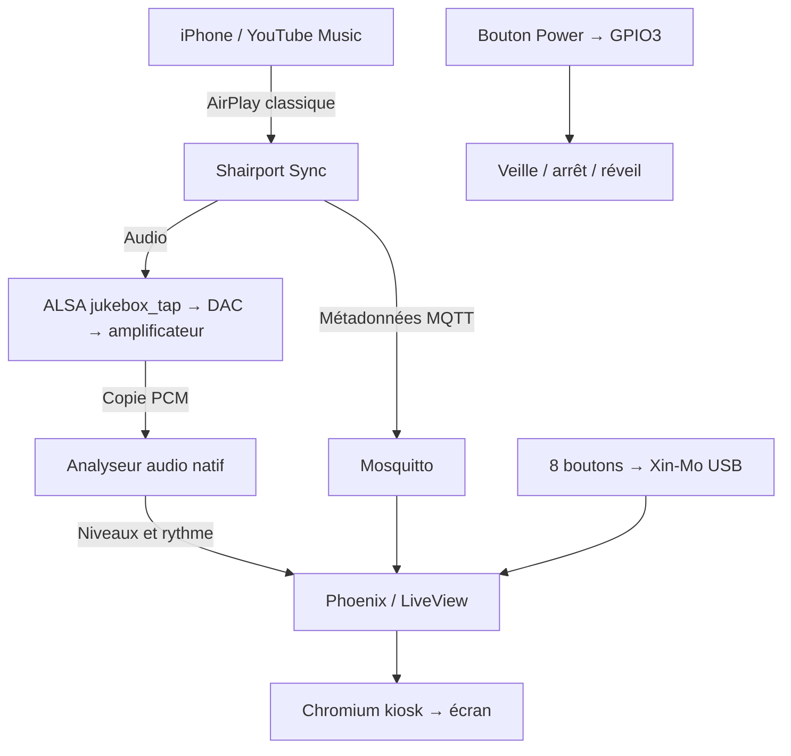
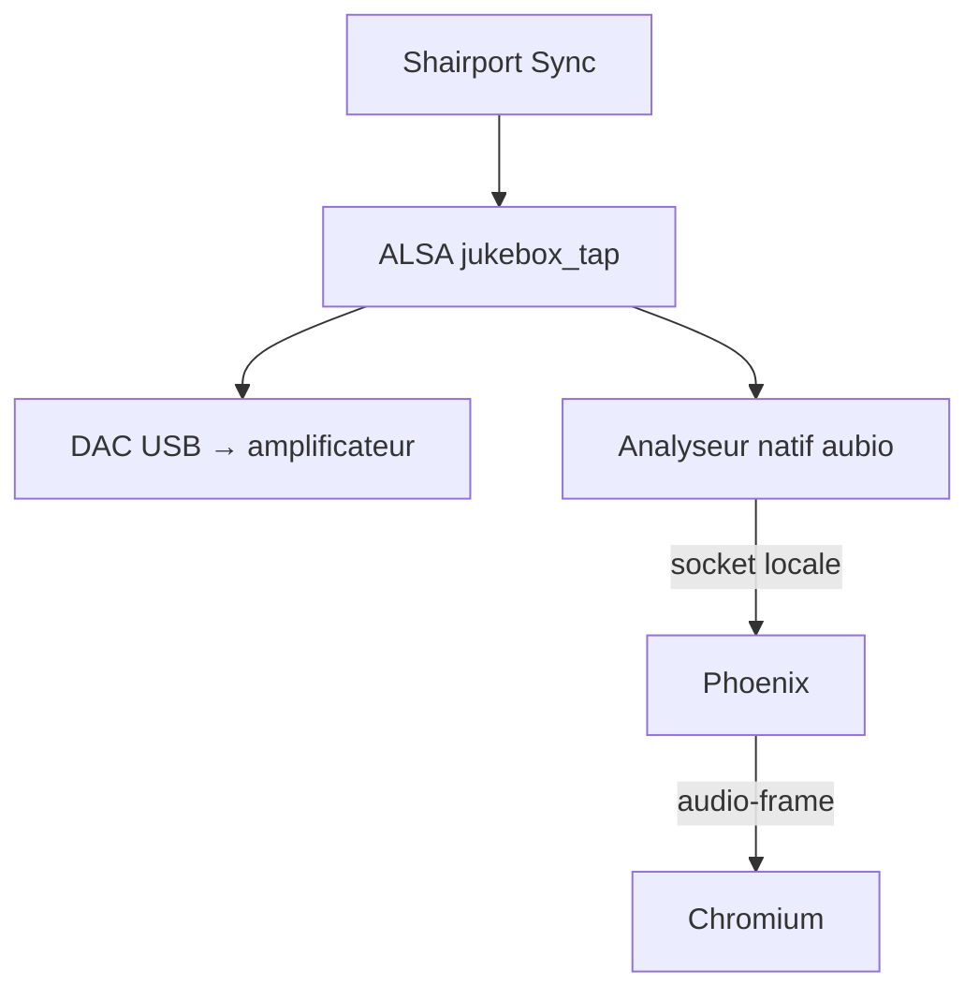

# Installation complète du jukebox sur Raspberry Pi 2 B

Guide mis à jour le 19 novembre 2026.

Ce guide part de zéro. Il suppose que tu disposes maintenant de :

- un Raspberry Pi 2 Model B avec 1 Go de RAM ;
- une carte microSD de 16 Go qui peut contenir une ancienne installation ;
- un écran HDMI non tactile ;
- une application Phoenix/LiveView terminée sur ton ordinateur ;
- un iPhone qui enverra la musique par AirPlay ;
- un amplificateur TPA3116D2 et des haut-parleurs passifs ;
- plus tard, des boutons physiques et des éclairages LED basse tension.

La cible est volontairement légère :

- Raspberry Pi OS Lite 32 bits ;
- aucune interface de bureau complète ;
- Shairport Sync relié explicitement au DAC USB ALSA, puis au périphérique de copie `jukebox_tap` pour les animations audio-réactives ;
- Mosquitto pour les métadonnées et les commandes ;
- Phoenix sous forme de release de production ARMv7 ;
- X11, Openbox et un seul Chromium en mode kiosk ;
- services `systemd` pour tout relancer automatiquement.



Le Pi 2 est assez puissant pour l'audio et Phoenix. Chromium sera le composant limitant. Nous éviterons donc Docker, le bureau complet, les effets graphiques lourds et les services inutiles.

> Important : ne commence pas encore les branchements GPIO, Xin-Mo ou MOSFET. On valide d'abord le système, le réseau, le son, AirPlay et l'application.

---

# Phase 0 — Préparer le matériel

## Matériel nécessaire pour l'installation

- Raspberry Pi 2 Model B ;
- alimentation micro-USB stable de 5 V / 2 à 2,5 A ;
- carte microSD de 16 Go ;
- lecteur de microSD pour le Mac ;
- écran et câble HDMI ;
- câble Ethernet relié à la box ;
- clavier USB uniquement pour le dépannage ;
- câble jack 3,5 mm ou DAC USB pour le son ;
- un autre ordinateur connecté au même réseau.

Le Pi 2 ne possède pas de Wi-Fi intégré. Le câble Ethernet est donc la solution recommandée. Une clé Wi-Fi USB compatible Linux pourra être ajoutée plus tard si le câble est impossible.

## Sauvegarder l'ancienne carte si nécessaire

Raspberry Pi Imager va effacer entièrement la carte. Si elle contient quelque chose d'important, crée d'abord une image de sauvegarde ou utilise une autre carte.

Une carte de 16 Go suffit pour ce montage minimal, mais une carte ancienne peut être lente ou usée. Pour la version définitive, une microSD neuve de 32 Go, A1/A2 ou High Endurance, restera préférable.

---

# Phase 1 — Installer Raspberry Pi OS Lite 32 bits

## 1. Installer Raspberry Pi Imager sur le Mac

Télécharge Raspberry Pi Imager depuis :

https://www.raspberrypi.com/software/

Installe puis ouvre l'application.

## 2. Écrire le bon système sur la microSD

Dans Raspberry Pi Imager :

1. `Choose Device` : sélectionne `Raspberry Pi 2` ou `Raspberry Pi 2 Model B`.
2. `Choose OS` : ouvre `Raspberry Pi OS (other)`.
3. Sélectionne **Raspberry Pi OS Lite (32-bit)**.
4. Vérifie qu'il s'agit bien de la version 32 bits sans environnement graphique.
5. Ne sélectionne ni 64 bits, ni Desktop, ni Full.
6. `Choose Storage` : sélectionne uniquement la carte de 16 Go.

À la date de ce guide, la version courante est basée sur Debian 13 `trixie`, compatible avec tous les Raspberry Pi et occupant environ 2,6 Go après installation. Elle fournit aussi une version récente d'Elixir, ce qui simplifie le déploiement de l'application Phoenix.

Dans les réglages avancés d'Imager, utilise :

| Réglage | Valeur |
| --- | --- |
| Hostname | `jukebox` |
| Username | `jukebox` |
| Password | un mot de passe provisoire solide |
| Timezone | `Europe/Paris` |
| Keyboard | `fr` |
| SSH | activé, mot de passe autorisé pour le premier démarrage |

Tu peux laisser les champs Wi-Fi vides si tu utilises Ethernet. Si tu possèdes déjà une clé Wi-Fi USB compatible, tu peux saisir le SSID, le mot de passe et le pays `FR`, mais garde l'Ethernet branché pour la première installation.

Lance `Write`, confirme l'effacement puis attends la fin de la vérification.

## 3. Premier démarrage

Raspberry totalement débranché :

1. insère la carte microSD ;
2. branche l'écran HDMI ;
3. branche le câble Ethernet ;
4. branche temporairement un clavier si tu le souhaites ;
5. ne branche encore aucun bouton ou MOSFET sur les GPIO ;
6. branche l'alimentation micro-USB en dernier.

Attends trois à cinq minutes pour le premier démarrage.

## 4. Se connecter en SSH depuis le Mac

Dans Terminal :

```bash
ssh jukebox@jukebox.local
```

Réponds `yes`, puis saisis le mot de passe créé dans Imager.

Si le nom local ne répond pas, récupère l'adresse IP dans l'interface de ta box, puis utilise par exemple :

```bash
ssh jukebox@192.168.1.42
```

## 5. Vérifier que la bonne architecture est installée

```bash
cat /proc/device-tree/model
echo
uname -m
dpkg --print-architecture
cat /etc/os-release
free -h
df -h /
```

Résultats attendus :

- le modèle contient `Raspberry Pi 2 Model B` ;
- `uname -m` affiche normalement `armv7l` ;
- l'architecture Debian est `armhf` ;
- le système est 32 bits ;
- la mémoire totale est proche de 1 Go ;
- plusieurs gigaoctets restent libres.

Même si certaines révisions du Pi 2 possèdent un processeur capable de 64 bits, nous conservons volontairement l'OS 32 bits pour assurer la compatibilité avec toutes les révisions.

## 6. Mettre le système à jour

```bash
sudo apt update
sudo apt -y full-upgrade
sudo apt clean
sudo reboot
```

Attends deux à trois minutes, puis reconnecte-toi en SSH.

## 7. Installer les outils de base

```bash
sudo apt install -y --no-install-recommends \
  git curl ca-certificates rsync nano htop file openssl \
  build-essential pkg-config \
  alsa-utils avahi-daemon avahi-utils \
  mosquitto mosquitto-clients
```

Active Avahi, qui permet à l'iPhone de découvrir le jukebox sur le réseau :

```bash
sudo systemctl enable --now avahi-daemon
systemctl is-active avahi-daemon
```

La dernière commande doit répondre `active`.

## 8. Limiter les journaux sur la carte de 16 Go

```bash
sudo mkdir -p /etc/systemd/journald.conf.d
sudo nano /etc/systemd/journald.conf.d/jukebox.conf
```

Ajoute :

```ini
[Journal]
SystemMaxUse=100M
RuntimeMaxUse=50M
MaxRetentionSec=7day
```

Puis applique :

```bash
sudo systemctl restart systemd-journald
sudo journalctl --vacuum-size=100M
df -h /
```

---

# Phase 2 — Installer un environnement graphique minimal

Nous n'installons pas le bureau Raspberry Pi. Nous ajoutons uniquement ce dont Chromium a besoin.

```bash
sudo apt install -y --no-install-recommends \
  xserver-xorg x11-xserver-utils xinit openbox \
  chromium unclutter
```

Ajoute l'utilisateur aux groupes utiles :

```bash
sudo usermod -aG audio,video,input,render,gpio jukebox
```

Configure une connexion automatique sur la console :

```bash
sudo raspi-config
```

Dans les menus :

1. `System Options` ;
2. `Boot / Auto Login` ;
3. choisis **Console Autologin** ;
4. ne choisis pas Desktop Autologin ;
5. quitte avec `Finish` sans ajouter encore le lancement de Chromium.

Nous terminerons la configuration kiosk après avoir installé Phoenix.

---

# Phase 3 — Valider le son avant AirPlay

Ne continue pas tant que Linux ne produit pas un son correct.

## 1. Brancher le DAC USB

Cette installation utilise explicitement le DAC USB. Branche le DAC au Pi, puis sa sortie analogique à l'amplificateur. La sortie audio `default` du système ne sera pas utilisée, car elle peut pointer vers HDMI ou vers une autre carte.

Commence avec le volume de l'amplificateur très bas.

## 2. Lister les périphériques ALSA

```bash
aplay -l
aplay -L
```

Conserve cette sortie. Le nom exact du DAC servira éventuellement dans la configuration Shairport.

## 3. Identifier et tester explicitement le DAC USB

Dans cette installation, le périphérique attendu est :

```text
plughw:CARD=Audio,DEV=0
```

Vérifie qu'il existe :

```bash
aplay -L | grep -A2 -B1 'CARD=Audio'
```

Si le nom est différent, conserve le nom réellement affiché et remplace-le dans toutes les commandes suivantes.

```bash
speaker-test -D plughw:CARD=Audio,DEV=0 -c 2 -r 44100 -F S16_LE -t wav
```

Tu dois entendre alternativement `Front Left` et `Front Right`. Arrête avec `Ctrl+C`.

Si aucun son ne sort :

```bash
alsamixer
```

- `F6` : sélectionner la carte audio ;
- flèches : régler le volume ;
- `M` : retirer le mute ;
- `Esc` : quitter.

Ne continue pas tant que cette commande ne produit pas correctement les canaux gauche et droit. Le reste du guide utilise toujours ce périphérique précis, jamais `default`.

---

# Phase 4 — Configurer MQTT localement

Mosquitto doit être accessible uniquement depuis le Raspberry.

```bash
sudo nano /etc/mosquitto/conf.d/jukebox-local.conf
```

Ajoute :

```conf
listener 1883 127.0.0.1
allow_anonymous true
persistence false
```

Puis :

```bash
sudo systemctl enable --now mosquitto
sudo systemctl restart mosquitto
systemctl is-active mosquitto
```

Test rapide dans une première session SSH :

```bash
mosquitto_sub -h 127.0.0.1 -t jukebox/test
```

Dans une seconde session :

```bash
mosquitto_pub -h 127.0.0.1 -t jukebox/test -m bonjour
```

La première session doit afficher `bonjour`. Arrête-la avec `Ctrl+C`.

---

# Phase 5 — Installer Shairport Sync

Nous utilisons **AirPlay classique** dans la première version : il est suffisant pour un seul jukebox et permet le contrôle distant le plus mature dans Shairport Sync.

Sur Raspberry Pi OS Lite, il n'y a ni PipeWire ni PulseAudio. Shairport utilisera donc ALSA directement et fonctionnera comme service système.

## 1. Installer les dépendances

```bash
sudo apt install -y --no-install-recommends \
  autoconf automake libtool \
  libpopt-dev libconfig-dev libasound2-dev \
  libavahi-client-dev libssl-dev libsoxr-dev \
  libavutil-dev libavcodec-dev libavformat-dev \
  libmosquitto-dev
```

Sous Debian 13 `trixie`, Shairport demande également `systemd-dev`. Vérifie d'abord ce que ferait APT :

```bash
sudo apt install --dry-run --no-install-recommends systemd-dev
```

Si aucune suppression ou rétrogradation importante n'est proposée :

```bash
sudo apt install -y --no-install-recommends systemd-dev
```

En cas de proposition inhabituelle, ne confirme pas et conserve la sortie.

## 2. Télécharger et compiler

```bash
mkdir -p /home/jukebox/src
cd /home/jukebox/src
git clone --depth 1 https://github.com/mikebrady/shairport-sync.git
cd shairport-sync
autoreconf -fi
./configure \
  --sysconfdir=/etc \
  --with-alsa \
  --with-soxr \
  --with-avahi \
  --with-ssl=openssl \
  --with-systemd-startup \
  --with-ffmpeg \
  --with-mqtt-client
make -j1
sudo make install
```

`make -j1` est volontaire : il réduit le risque de manquer de mémoire sur le Pi 2.

## 3. Vérifier les fonctions compilées

```bash
shairport-sync -V
```

La chaîne doit mentionner au minimum ALSA, Avahi, metadata et MQTT. Si `mqtt` est absent, ne continue pas.

## 4. Configurer Shairport

```bash
sudo cp /etc/shairport-sync.conf /etc/shairport-sync.conf.original
sudo nano /etc/shairport-sync.conf
```

Remplace le contenu par :

```conf
general =
{
  name = "Jukebox";
  output_backend = "alsa";
  interpolation = "auto";
  default_airplay_volume = -12.0;
  volume_range_db = 30;
};

alsa =
{
  output_device = "plughw:CARD=Audio,DEV=0";
};

metadata =
{
  enabled = "yes";
  include_cover_art = "yes";
  cover_art_cache_directory = "/tmp/shairport-sync/.cache/coverart";
  progress_interval = 1.0;
};

sessioncontrol =
{
  active_state_timeout = 10.0;
};

mqtt =
{
  enabled = "yes";
  hostname = "127.0.0.1";
  port = 1883;
  topic = "jukebox/shairport";
  publish_raw = "yes";
  publish_parsed = "yes";
  publish_cover = "yes";
  publish_retain = "no";
  enable_remote = "yes";
};
```

Si ton DAC porte un autre nom dans `aplay -L`, utilise ce nom exact. Ne remplace pas cette valeur par `default`.

## 5. Activer le service système

```bash
sudo systemctl daemon-reload
sudo systemctl enable --now shairport-sync
sudo systemctl status shairport-sync --no-pager
```

Il doit être `active (running)`.

Si le service ne peut pas ouvrir ALSA :

```bash
systemctl show shairport-sync -p User
journalctl -u shairport-sync -n 100 --no-pager
```

Ne crée pas parallèlement un service utilisateur : une seule instance Shairport doit fonctionner.

## 6. Tester AirPlay

1. vérifie que l'iPhone est connecté au même réseau que le Pi ;
2. lance une chanson dans YouTube Music ;
3. ouvre le sélecteur AirPlay ;
4. sélectionne `Jukebox` ;
5. vérifie le son et le volume.

Pour suivre les logs :

```bash
journalctl -u shairport-sync -f
```

## 7. Tester les métadonnées MQTT

```bash
mosquitto_sub -h 127.0.0.1 -v -t 'jukebox/shairport/#'
```

Change de morceau. Tu devrais voir notamment `title`, `artist`, `album`, `play_start`, `active_start` et éventuellement la pochette binaire.

## 8. Tester les commandes vers l'iPhone

Pendant la lecture :

```bash
mosquitto_pub -h 127.0.0.1 \
  -t 'jukebox/shairport/remote' \
  -m 'playpause'
```

Puis :

```bash
mosquitto_pub -h 127.0.0.1 -t 'jukebox/shairport/remote' -m 'nextitem'
mosquitto_pub -h 127.0.0.1 -t 'jukebox/shairport/remote' -m 'previtem'
```

Ces commandes dépendent aussi du client AirPlay et de YouTube Music. Si elles ne fonctionnent pas mais que l'audio fonctionne, le problème ne vient pas du Pi 2.

---

# Phase 6 — Installer le code source de l'application

Le dépôt complet doit se trouver dans `/home/jukebox/src/jukebox-app`. La release exécutable sera ensuite installée séparément dans `/opt/jukebox`.

## 1. Préparer le répertoire source

```bash
mkdir -p /home/jukebox/src/jukebox-app
```

## 2. Copier le projet depuis le Mac

Depuis le Mac, adapte le chemin local :

```bash
rsync -av --delete \
  --exclude '_build' \
  --exclude 'deps' \
  --exclude 'assets/node_modules' \
  /chemin/vers/application-jukebox/ \
  jukebox@jukebox.local:/home/jukebox/src/jukebox-app/
```

Si le projet est hébergé dans Git, tu peux à la place le cloner directement :

```bash
mkdir -p /home/jukebox/src
git clone URL_DU_DEPOT /home/jukebox/src/jukebox-app
```

N'ajoute jamais de token directement dans l'URL.

## 3. Vérifier le dépôt fourni par Fable

```bash
cd /home/jukebox/src/jukebox-app
grep -n 'app:' mix.exs | head
grep -n 'elixir:' mix.exs | head
find ops docs rel native -maxdepth 3 -type f -print 2>/dev/null | sort
```

Le guide utilise `jukebox` comme nom de release. L'application n'utilise pas de base de données : PostgreSQL, Ecto et les migrations ne font pas partie de cette installation.

---

# Phase 7 — Installer Elixir et compiler une release ARMv7

Une release compilée sur macOS, x86_64 ou ARM64 ne peut pas fonctionner sur ce Pi. Elle doit contenir une VM Erlang Linux `armhf/armv7` compatible.

## 1. Installer Elixir et Erlang

```bash
sudo apt install -y elixir erlang-dev
elixir --version
```

Sur Debian 13, la version fournie est normalement Elixir 1.18.x avec Erlang/OTP 27.x. Compare-la à `mix.exs`, `.tool-versions` ou `mise.toml`.

Si la contrainte n'est pas respectée, arrête-toi : ne modifie pas artificiellement `mix.exs`. Il faudra produire la release ARMv7 avec la bonne paire Erlang/Elixir.

## 2. Installer Hex et Rebar

```bash
mix local.hex --force
mix local.rebar --force
```

## 3. Installer Node uniquement si le projet en a besoin

Si `assets/package.json` existe et que les alias Mix lancent `npm` :

```bash
sudo apt install -y nodejs npm
```

Si l'application utilise uniquement les wrappers `esbuild` et `tailwind` d'Elixir, cette installation peut être inutile.

## 4. Compiler et lancer les tests

```bash
cd /home/jukebox/src/jukebox-app
mix deps.get
mix compile --warnings-as-errors
mix test
```

Le Pi 2 peut mettre longtemps. Ne ferme pas la session pendant la compilation.

Si le processus est tué faute de mémoire, crée temporairement 1 Go de swap :

```bash
sudo fallocate -l 1G /swapfile-build
sudo chmod 600 /swapfile-build
sudo mkswap /swapfile-build
sudo swapon /swapfile-build
free -h
```

Après la compilation complète, retire ce swap temporaire :

```bash
sudo swapoff /swapfile-build
sudo rm /swapfile-build
```

## 5. Construire les assets et la release

### Limite importante de Tailwind sur le Pi 2

Tailwind CSS 4 ne fournit pas de binaire Linux ARMv7. Si l'application utilise Tailwind 4, `mix assets.deploy` échouera sur le Pi avec une URL se terminant par `tailwindcss-linux-armv7`.

Dans ce cas, construis les assets sur le Mac :

```bash
cd /chemin/vers/application-jukebox
MIX_ENV=prod mix deps.get --only prod
MIX_ENV=prod mix assets.deploy
rsync -av priv/static/ jukebox@jukebox.local:/home/jukebox/src/jukebox-app/priv/static/
```

Les fichiers de `priv/static` sont indépendants de l'architecture. En revanche, la release Erlang doit toujours être compilée sur le Pi ARMv7.

Sur le Pi :

```bash
cd /home/jukebox/src/jukebox-app
MIX_ENV=prod mix deps.get --only prod
MIX_ENV=prod mix compile
MIX_ENV=prod mix release --overwrite
```

Si le dépôt n'utilise pas Tailwind 4 et que `mix assets.deploy` fonctionne réellement sur ARMv7, il est possible de lancer cette commande sur le Pi avant `mix release`. Ne la relance pas sur le Pi lorsque les assets ont déjà été générés sur le Mac.

Trouve son nom :

```bash
find _build/prod/rel -mindepth 1 -maxdepth 1 -type d -printf '%f\n'
```

Puis vérifie qu'elle est bien construite sur le Pi :

```bash
file _build/prod/rel/jukebox/erts-*/bin/beam.smp
```

La sortie doit correspondre à un exécutable ELF 32 bits ARM.

## 6. Installer la release

```bash
sudo mkdir -p /opt/jukebox
sudo rsync -a --delete \
  /home/jukebox/src/jukebox-app/_build/prod/rel/jukebox/ \
  /opt/jukebox/
sudo chown -R jukebox:jukebox /opt/jukebox
```

Adapte `jukebox` si le vrai nom est différent.

---

# Phase 8 — Configurer Phoenix comme service

## 1. Générer le secret Phoenix

```bash
cd /home/jukebox/src/jukebox-app
mix phx.gen.secret
```

Conserve cette valeur sans la publier.

## 2. Installer les fichiers fournis par le dépôt

Le dépôt contient déjà le fichier d'environnement et l'unité `systemd` adaptés à l'application. Utilise-les : ne recrée pas un service générique à la main.

Repère-les si nécessaire :

```bash
cd /home/jukebox/src/jukebox-app
find ops -type f \( -name 'jukebox.env*' -o -name 'jukebox.service*' \) -print
```

Installe le modèle d'environnement fourni sous le chemin définitif :

```bash
sudo install -d -m 755 /etc/jukebox
# Adapte uniquement le chemin source si find a affiché un sous-répertoire différent.
sudo install -m 600 ops/jukebox.env.example /etc/jukebox/jukebox.env
sudo nano /etc/jukebox/jukebox.env
```

Dans ce fichier, remplace les valeurs d'exemple, notamment :

```text
PHX_SERVER=true
PHX_HOST=localhost
PORT=4000
SECRET_KEY_BASE=COLLER_ICI_LE_SECRET
```

Conserve les variables MQTT et jukebox déjà présentes dans le modèle. Il ne faut ni `DATABASE_URL`, ni configuration PostgreSQL, ni commande de migration.

Protège le fichier :

```bash
sudo chown root:root /etc/jukebox/jukebox.env
sudo chmod 600 /etc/jukebox/jukebox.env
```

Installe ensuite le service fourni par le dépôt :

```bash
sudo install -m 644 ops/jukebox.service /etc/systemd/system/jukebox.service
sudo systemctl daemon-reload
```

Vérifie les points importants :

```bash
sudo systemctl cat jukebox
```

Le service doit utiliser `/opt/jukebox`, s'exécuter comme `jukebox` et charger `EnvironmentFile=/etc/jukebox/jukebox.env`.

## 3. Démarrer Phoenix

```bash
sudo systemctl daemon-reload
sudo systemctl enable --now jukebox
sudo systemctl status jukebox --no-pager
curl --fail http://127.0.0.1:4000/ >/dev/null && echo 'Phoenix OK'
```

En cas d'erreur :

```bash
journalctl -u jukebox -n 150 --no-pager
```

---

# Phase 9 — Démarrer sur la console et lancer Chromium en mode kiosk

Le Pi doit démarrer sur une console texte avec ouverture automatique de la session `jukebox`. Cette session lance ensuite X11, Openbox et Chromium. Il ne faut pas démarrer un bureau Wayfire/Labwc ni afficher un écran de connexion graphique.

## 1. Forcer le démarrage console avec autologin

```bash
sudo raspi-config nonint do_boot_behaviour B2
sudo systemctl set-default multi-user.target
systemctl get-default
```

La dernière commande doit afficher :

```text
multi-user.target
```

Vérifie s'il existe encore un gestionnaire de connexion graphique :

```bash
systemctl status display-manager --no-pager
```

Sur Raspberry Pi OS Lite, l'unité est normalement absente. Si la machine affiche malgré tout un écran de connexion et que la commande identifie `lightdm.service`, désactive-le :

```bash
sudo systemctl disable lightdm.service
```

Ne lance pas `lightdm`, Wayfire, Labwc ou le bureau Raspberry Pi en parallèle du kiosk.

## 2. Créer le script X11

```bash
nano /home/jukebox/.xinitrc
```

Ajoute :

```bash
#!/bin/sh

xset +dpms
xset dpms 0 0 0
xset s off
xset s noblank
xsetroot -solid black

unclutter -idle 0.2 -root &
openbox-session &

until curl --max-time 2 --fail --silent http://127.0.0.1:4000/ >/dev/null; do
  sleep 1
done

exec chromium \
  --ozone-platform=x11 \
  --kiosk \
  --noerrdialogs \
  --no-first-run \
  --disable-infobars \
  --disable-session-crashed-bubble \
  --disable-background-networking \
  --disable-component-update \
  --disable-features=Translate \
  --renderer-process-limit=2 \
  --disk-cache-size=52428800 \
  --media-cache-size=52428800 \
  --autoplay-policy=no-user-gesture-required \
  http://127.0.0.1:4000/
```

Puis :

```bash
chmod +x /home/jukebox/.xinitrc
```

Ne rajoute pas `--disable-gpu` : le Pi 2 a besoin de son accélération graphique pour afficher correctement l'interface.

## 3. Lancer X automatiquement uniquement sur la console locale

```bash
nano /home/jukebox/.bash_profile
```

Ajoute :

```bash
if [ -z "$DISPLAY" ] && [ "${XDG_VTNR:-0}" = "1" ]; then
  exec startx
fi
```

Cette condition ne lance pas Chromium dans les connexions SSH.

Corrige les propriétaires et permissions :

```bash
sudo chown jukebox:jukebox /home/jukebox/.bash_profile /home/jukebox/.xinitrc
chmod 644 /home/jukebox/.bash_profile
chmod 755 /home/jukebox/.xinitrc
```

## 4. Tester les exécutables avant de redémarrer

```bash
command -v startx
command -v openbox-session
command -v chromium
systemctl is-active jukebox
curl --fail http://127.0.0.1:4000/ >/dev/null && echo 'Phoenix OK'
```

Les trois premières commandes doivent afficher un chemin et les deux dernières validations doivent réussir.

## 5. Tester le démarrage complet

```bash
sudo reboot
```

Résultat attendu :

1. Linux démarre ;
2. la console ouvre automatiquement la session `jukebox` ;
3. Shairport, Mosquitto et Phoenix démarrent ;
4. X11 et Openbox se lancent ;
5. Chromium attend que Phoenix réponde ;
6. l'interface apparaît en plein écran.

Le Pi 2 peut mettre une à deux minutes avant d'afficher l'application.

Si un écran de connexion apparaît encore :

```bash
systemctl get-default
sudo systemctl cat getty@tty1.service
systemctl status display-manager --no-pager
```

Si tu te connectes manuellement à un bureau graphique, `.bash_profile` n'est pas utilisé pour lancer `startx` : il est donc normal que le Chromium du guide ne démarre pas dans cette session. Il faut corriger l'autologin console, pas ajouter un deuxième autostart Chromium au bureau.

Pour dépanner avec un clavier lorsque le kiosk est affiché, utilise `Ctrl+Alt+F2`, connecte-toi sur la seconde console, puis `Ctrl+Alt+F1` pour revenir au kiosk. Depuis SSH, les logs utiles sont :

```bash
journalctl -b -u getty@tty1 --no-pager
journalctl -b --no-pager | grep -iE 'startx|xorg|openbox|chromium'
```

## 6. Vérifier la mémoire

Depuis SSH :

```bash
free -h
ps -eo pid,comm,rss,%mem --sort=-rss | head -n 15
df -h /
```

Si Chromium est lent :

- retire les flous CSS continus et les animations WebGL ;
- réduis la taille des pochettes côté application ;
- conserve uniquement les animations `opacity` et `transform` ;
- teste une résolution 1280 × 720 ;
- vérifie que le système n'utilise pas continuellement le swap.

---

# Phase 10 — Activer les animations audio-réactives

Cette phase ajoute une copie du PCM joué par Shairport Sync. Le son continue vers le DAC USB ; un analyseur natif calcule le volume, les basses, les attaques, les pulsations et le tempo, puis transmet uniquement ces nombres à Phoenix.



La copie ALSA arrive en retard d'environ un tampon. C'est pourquoi `buffer_size = 8820` est obligatoire au départ et `AUDIO_VISUAL_DELAY_MS` vaut `0` sur le Pi. Ces valeurs devront être validées sur le matériel.

## 1. Déployer la version comprenant l'analyseur

Après avoir copié la nouvelle version du dépôt dans `/home/jukebox/src/jukebox-app`, reconstruis la release selon la Phase 7. Pour une mise à jour déjà compilable sur le Pi :

```bash
cd /home/jukebox/src/jukebox-app
export MIX_ENV=prod
mix deps.get --only prod
mix compile
# Ne lance mix assets.deploy ici que si les assets ne sont pas en Tailwind 4 ARMv7.
mix release --overwrite
sudo systemctl stop jukebox
sudo rsync -a --delete _build/prod/rel/jukebox/ /opt/jukebox/
sudo chown -R jukebox:jukebox /opt/jukebox
sudo systemctl start jukebox
```

Si Tailwind 4 est utilisé, génère d'abord `priv/static` sur le Mac comme indiqué dans la Phase 7.

## 2. Sauvegarder la configuration actuelle

```bash
sudo cp -p /etc/shairport-sync.conf /etc/shairport-sync.conf.before-jukebox-tap
sudo cp -p /etc/jukebox/jukebox.env /etc/jukebox/jukebox.env.before-jukebox-tap
```

Vérifie que le son AirPlay fonctionne encore directement sur le DAC avant de poursuivre.

## 3. Installer les dépendances, compiler et tester

```bash
sudo apt update
sudo apt install -y build-essential pkg-config libaubio-dev alsa-utils
cd /home/jukebox/src/jukebox-app
make -C native/jukebox_audio_analyzer
make -C native/jukebox_audio_analyzer test
```

Ne continue pas si un test échoue. Vérifie aussi :

```bash
native/jukebox_audio_analyzer/build/jukebox_audio_analyzer --version
```

Si le compilateur ARMv7 refuse les options CPU du Makefile :

```bash
make -C native/jukebox_audio_analyzer clean
make -C native/jukebox_audio_analyzer ARCH_CFLAGS=
make -C native/jukebox_audio_analyzer test
```

## 4. Installer le tap ALSA

```bash
cd /home/jukebox/src/jukebox-app
sudo sh ops/audio/install-audio-tap.sh
```

Le script installe l'analyseur et son wrapper dans `/opt/jukebox/bin`, crée le groupe `jukebox-audio`, prépare `/run/jukebox` à chaque démarrage et installe le périphérique ALSA `jukebox_tap`. Il ne change pas encore la sortie utilisée par Shairport.

Vérifie :

```bash
aplay -L | grep -A1 '^jukebox_tap'
ls -ld /run/jukebox
id shairport-sync
```

Résultats attendus :

- `jukebox_tap` apparaît ;
- `/run/jukebox` appartient à `jukebox:jukebox-audio` ;
- l'utilisateur `shairport-sync` appartient au groupe `jukebox-audio`.

Si Shairport utilise un autre utilisateur ou si le DAC porte un autre nom :

```bash
systemctl show -p User shairport-sync
sudo SHAIRPORT_USER=UTILISATEUR_REEL \
  JUKEBOX_DAC='plughw:CARD=Audio,DEV=0' \
  sh ops/audio/install-audio-tap.sh
```

## 5. Activer la réception dans Phoenix

Édite le fichier réellement utilisé par le service :

```bash
sudo nano /etc/jukebox/jukebox.env
```

Ajoute ou modifie :

```text
AUDIO_REACTIVE_ENABLED=true
AUDIO_REACTIVE_SOURCE=native
AUDIO_ANALYSIS_SOCKET=/run/jukebox/audio-analysis.sock
AUDIO_ANALYSIS_PUBLISH_RATE=20
AUDIO_VISUAL_DELAY_MS=0
AUDIO_BEAT_CONFIDENCE_THRESHOLD=0.45
```

Puis :

```bash
sudo systemctl restart jukebox
journalctl -u jukebox -n 30 --no-pager | grep audio
sudo ls -l /run/jukebox
```

La socket `audio-analysis.sock` doit appartenir à `jukebox:jukebox-audio` et être accessible en écriture par le groupe.

## 6. Tester le tap sans AirPlay

Arrête toute lecture AirPlay, baisse le volume de l'amplificateur puis lance :

```bash
sudo -u shairport-sync speaker-test \
  -D jukebox_tap -c 2 -r 44100 -F S16_LE -t sine -f 440 -l 1
```

Tu dois entendre le son sans message d'erreur de l'analyseur. Vérifie que Phoenix a reçu des trames :

```bash
sudo -H -u jukebox /opt/jukebox/bin/jukebox rpc \
  'IO.inspect(Jukebox.AudioAnalysis.NativeSource.status())'
```

`received` doit être supérieur à zéro et `rejected` doit rester à zéro.

## 7. Faire passer Shairport par le tap

Édite :

```bash
sudo nano /etc/shairport-sync.conf
```

La section `alsa` doit devenir :

```conf
alsa =
{
  output_device = "jukebox_tap";
  output_format = "S16";
  buffer_size = 8820;
};
```

Ne modifie pas les réglages de volume de la section `general` lors de cette bascule :

```conf
default_airplay_volume = -12.0;
volume_range_db = 30;
```

Puis :

```bash
sudo systemctl restart shairport-sync
systemctl is-active shairport-sync
journalctl -u shairport-sync -n 50 --no-pager
```

Si Shairport ne démarre plus ou si le son a disparu, reviens immédiatement au DAC direct :

```bash
sudo sh /home/jukebox/src/jukebox-app/ops/audio/rollback-audio-tap.sh
```

## 8. Tester avec de la musique

Depuis l'iPhone, lance une musique AirPlay. Dans les modes d'animation autres que `calm` :

- les vagues doivent suivre le volume ;
- la pochette et son halo doivent réagir aux basses ;
- les ampoules doivent diminuer dans les passages calmes ;
- les modes `chase` et `party` doivent avancer sur les pulsations détectées lorsque la confiance est suffisante ;
- sinon, le tempo fixe existant doit prendre le relais.

Pendant la lecture :

```bash
pgrep -af jukebox_audio_analyzer
sudo -H -u jukebox /opt/jukebox/bin/jukebox rpc \
  'IO.inspect(Jukebox.AudioAnalysis.NativeSource.status())'
```

## 9. Régler la latence et la confiance

Commence avec :

```text
buffer_size = 8820
AUDIO_VISUAL_DELAY_MS=0
AUDIO_BEAT_CONFIDENCE_THRESHOLD=0.45
```

Teste avec un métronome ou une musique aux attaques nettes.

- Si l'image réagit après le son, réduis progressivement `buffer_size` : `8820`, puis `8000`, puis `7400`. Redémarre Shairport après chaque changement. Ne descends pas sous environ `7350`. Remonte immédiatement si le son saccade ou si Shairport refuse de démarrer.
- Si l'image réagit avant le son, augmente `AUDIO_VISUAL_DELAY_MS` par pas de 20 ms, puis redémarre `jukebox`.
- Si un rythme évident reste sur l'animation fixe, baisse le seuil vers `0.30`.
- Si les lumières détectent de faux rythmes, monte le seuil vers `0.60`.

aubio peut parfois détecter un multiple ou une fraction du vrai tempo. Ce n'est pas une panne : l'animation sera régulière mais ne tombera pas nécessairement sur chaque pulsation.

## 10. Surveiller le Pi 2

```bash
ps -o pid,pcpu,rss,etime,cmd \
  -p "$(pgrep -n -f /opt/jukebox/bin/jukebox_audio_analyzer)"
free -h
vmstat 5
journalctl -u shairport-sync --since '1 hour ago' --no-pager \
  | grep -iE 'underrun|xrun|resync|sync error'
```

Objectifs : analyseur sous environ 10 % d'un cœur, moins de 30 Mo de RAM, pas de swap croissant et aucune coupure audio. Si Chromium souffre, baisse `AUDIO_ANALYSIS_PUBLISH_RATE` à `10` et adapte aussi le `--publish-rate` dans la configuration ALSA fournie par le dépôt.

## 11. Retour arrière complet

Retour immédiat au DAC direct :

```bash
sudo sh /home/jukebox/src/jukebox-app/ops/audio/rollback-audio-tap.sh
```

Suppression du tap si nécessaire :

```bash
sudo sh /home/jukebox/src/jukebox-app/ops/audio/rollback-audio-tap.sh --remove
sudo nano /etc/jukebox/jukebox.env
# AUDIO_REACTIVE_ENABLED=false
sudo systemctl restart jukebox
```

L'application revient automatiquement à l'animation à tempo fixe lorsque l'analyse audio est indisponible.

---

# Phase 11 — Ajouter le bouton Power avec veille rapide et arrêt complet

Le bouton Power possède trois comportements :

| Action | Résultat |
| --- | --- |
| appui court lorsque le jukebox fonctionne | entrée en veille logicielle |
| nouvel appui court | sortie de veille en quelques secondes |
| appui maintenu au moins 3 secondes, puis relâché | arrêt Linux complet et propre |
| appui lorsque le Pi est en `HALT` | démarrage complet par GPIO3 |

En veille logicielle, Linux, Phoenix, Chromium, Shairport et le réseau continuent à fonctionner. L'écran, l'amplificateur et les éclairages sont coupés. La consommation du Pi continue donc, mais la reprise est rapide.

## 1. Ne pas utiliser `gpio-shutdown`

Le service logiciel doit pouvoir mesurer la durée de l'appui. Il ne faut donc pas charger l'overlay qui transforme immédiatement GPIO3 en événement Power.

```bash
sudo nano /boot/firmware/config.txt
```

Supprime ou commente cette ligne si elle est déjà présente :

```ini
# dtoverlay=gpio-shutdown
```

N'ajoute pas non plus `gpio-poweroff`. Le réveil matériel après un arrêt complet restera assuré par GPIO3.

## 2. Câbler le bouton

Éteins proprement le Pi, attends l'arrêt puis débranche son alimentation avant de toucher aux broches.

Utilise un bouton poussoir momentané normalement ouvert :

| Fonction | GPIO BCM | Broche physique |
| --- | ---: | ---: |
| Power | GPIO3 | 5 |
| Masse | GND | 6 |

Le contact relie simplement la broche 5 à la broche 6 pendant l'appui. Si le bouton possède `COM`, `NO` et `NC`, utilise `COM` et `NO`. Son éclairage 12 V reste sur un circuit totalement séparé.

## 3. Installer le contrôleur

```bash
sudo apt install -y python3-gpiozero
sudo nano /usr/local/sbin/jukebox-power-controller.py
```

Colle le programme suivant :

```python
#!/usr/bin/python3
import grp
import os
import signal
import socket
import subprocess
import sys
import threading
import time
import urllib.request

from gpiozero import Button, OutputDevice

SOCKET_PATH = "/run/jukebox/power-control.sock"
LONG_PRESS_SECONDS = 3.0
AMP_DELAY_SECONDS = 1.5

PINS = {
    "amp": 17,
    "disco": 27,
    "strip": 22,
    "decor": 23,
    "extra": 24,
}

DEFAULT_STATE = {
    "amp": True,
    "disco": False,
    "strip": True,
    "decor": True,
    "extra": True,
}

lock = threading.RLock()
stop_event = threading.Event()
desired = DEFAULT_STATE.copy()
outputs = {}
standby = False
press_started = None
server_socket = None


def set_display(on):
    env = os.environ.copy()
    env["DISPLAY"] = ":0"
    env["XAUTHORITY"] = "/home/jukebox/.Xauthority"
    command = ["/usr/bin/xset", "dpms", "force", "on" if on else "off"]
    subprocess.run(command, env=env, stdout=subprocess.DEVNULL,
                   stderr=subprocess.DEVNULL, check=False)


def all_outputs_off():
    with lock:
        for output in outputs.values():
            output.off()


def apply_non_amp_outputs():
    with lock:
        if standby:
            return
        for name, output in outputs.items():
            if name != "amp":
                output.value = desired[name]


def enter_standby():
    global standby
    with lock:
        if standby:
            return
        standby = True
        outputs["amp"].off()
        for name, output in outputs.items():
            if name != "amp":
                output.off()
    set_display(False)


def leave_standby():
    global standby
    with lock:
        standby = False
    set_display(True)
    apply_non_amp_outputs()
    time.sleep(AMP_DELAY_SECONDS)
    with lock:
        if not standby:
            outputs["amp"].value = desired["amp"]


def toggle_standby():
    with lock:
        is_standby = standby
    if is_standby:
        leave_standby()
    else:
        enter_standby()


def request_shutdown():
    global standby
    with lock:
        standby = True
    all_outputs_off()
    set_display(False)
    subprocess.Popen(["/usr/bin/systemctl", "poweroff"])


def set_output(name, action):
    if name not in desired:
        return
    with lock:
        if action == "on":
            desired[name] = True
        elif action == "off":
            desired[name] = False
        elif action == "toggle":
            desired[name] = not desired[name]
        else:
            return
        if not standby:
            outputs[name].value = desired[name]


def handle_command(message):
    parts = message.strip().lower().split()
    if not parts:
        return
    if parts == ["standby", "toggle"]:
        toggle_standby()
    elif parts == ["standby", "on"]:
        enter_standby()
    elif parts == ["standby", "off"]:
        leave_standby()
    elif parts == ["shutdown"]:
        request_shutdown()
    elif len(parts) == 2:
        set_output(parts[0], parts[1])


def on_button_pressed():
    global press_started
    press_started = time.monotonic()


def on_button_released():
    global press_started
    if press_started is None:
        return
    duration = time.monotonic() - press_started
    press_started = None
    if duration >= LONG_PRESS_SECONDS:
        request_shutdown()
    else:
        toggle_standby()


def socket_loop():
    global server_socket
    os.makedirs("/run/jukebox", exist_ok=True)
    try:
        os.unlink(SOCKET_PATH)
    except FileNotFoundError:
        pass
    server_socket = socket.socket(socket.AF_UNIX, socket.SOCK_DGRAM)
    server_socket.bind(SOCKET_PATH)
    os.chmod(SOCKET_PATH, 0o660)
    try:
        gid = grp.getgrnam("jukebox").gr_gid
        os.chown(SOCKET_PATH, -1, gid)
    except KeyError:
        pass
    server_socket.settimeout(0.5)
    while not stop_event.is_set():
        try:
            data = server_socket.recv(256)
        except socket.timeout:
            continue
        except OSError:
            break
        handle_command(data.decode("utf-8", errors="ignore"))


def wait_for_application():
    while not stop_event.is_set():
        try:
            with urllib.request.urlopen("http://127.0.0.1:4000/", timeout=2):
                break
        except Exception:
            stop_event.wait(1)
    if not stop_event.is_set():
        with lock:
            is_standby = standby
        if not is_standby:
            leave_standby()


def stop_service(signum, frame):
    stop_event.set()
    all_outputs_off()


def send_command(arguments):
    client = socket.socket(socket.AF_UNIX, socket.SOCK_DGRAM)
    try:
        client.sendto(" ".join(arguments).encode("utf-8"), SOCKET_PATH)
    finally:
        client.close()


def run_daemon():
    global outputs
    signal.signal(signal.SIGTERM, stop_service)
    signal.signal(signal.SIGINT, stop_service)
    outputs = {
        name: OutputDevice(pin, active_high=True, initial_value=False)
        for name, pin in PINS.items()
    }
    power_button = Button(3, pull_up=True, bounce_time=0.08)
    power_button.when_pressed = on_button_pressed
    power_button.when_released = on_button_released
    threading.Thread(target=socket_loop, daemon=True).start()
    threading.Thread(target=wait_for_application, daemon=True).start()
    stop_event.wait()
    all_outputs_off()
    if server_socket is not None:
        server_socket.close()
    try:
        os.unlink(SOCKET_PATH)
    except FileNotFoundError:
        pass
    power_button.close()
    for output in outputs.values():
        output.close()


if __name__ == "__main__":
    if len(sys.argv) == 2 and sys.argv[1] == "--daemon":
        run_daemon()
    elif len(sys.argv) >= 2:
        send_command(sys.argv[1:])
    else:
        print("usage: jukebox-power-controller.py --daemon | COMMAND", file=sys.stderr)
        sys.exit(2)
```

Puis :

```bash
sudo chmod 755 /usr/local/sbin/jukebox-power-controller.py
sudo python3 -m py_compile /usr/local/sbin/jukebox-power-controller.py
```

La seconde commande ne doit rien afficher.

## 4. Créer le service systemd

```bash
sudo nano /etc/systemd/system/jukebox-power-controller.service
```

Ajoute :

```ini
[Unit]
Description=Jukebox power button, standby and low-voltage outputs
After=local-fs.target jukebox.service
Wants=jukebox.service

[Service]
Type=simple
ExecStart=/usr/local/sbin/jukebox-power-controller.py --daemon
Restart=on-failure
RestartSec=2
TimeoutStopSec=5

[Install]
WantedBy=multi-user.target
```

Active-le :

```bash
sudo systemctl daemon-reload
sudo systemctl enable --now jukebox-power-controller
sudo systemctl status jukebox-power-controller --no-pager
```

Le service tourne comme `root` uniquement parce qu'il doit commander les GPIO et demander l'arrêt du système. Sa socket locale est accessible au groupe `jukebox` pour que Phoenix puisse lui transmettre des commandes limitées.

## 5. Commandes locales disponibles

Le même programme sert de client :

```bash
sudo -u jukebox /usr/local/sbin/jukebox-power-controller.py standby toggle
sudo -u jukebox /usr/local/sbin/jukebox-power-controller.py disco toggle
sudo -u jukebox /usr/local/sbin/jukebox-power-controller.py strip toggle
sudo -u jukebox /usr/local/sbin/jukebox-power-controller.py decor toggle
sudo -u jukebox /usr/local/sbin/jukebox-power-controller.py extra toggle
```

Les boutons Xin-Mo `Disco + panneau` et `Ruban LED` devront appeler respectivement les commandes `disco toggle` et `strip toggle`. Le service reste l'unique propriétaire des GPIO de puissance ; Phoenix ne doit pas ouvrir ces GPIO directement.

## 6. Tester d'abord sans charges de puissance

Laisse les MOSFET et l'amplificateur déconnectés pour ce premier test.

1. redémarre le Pi ;
2. attends l'apparition du kiosk ;
3. appuie brièvement : l'écran doit passer en veille ;
4. appuie de nouveau : l'écran doit revenir en quelques secondes ;
5. maintiens le bouton au moins trois secondes, puis relâche-le ;
6. Linux doit effectuer un arrêt propre ;
7. attends l'arrêt complet, puis appuie brièvement ;
8. GPIO3 doit provoquer un démarrage complet.

Logs utiles :

```bash
systemctl status jukebox-power-controller --no-pager
journalctl -u jukebox-power-controller -b --no-pager
```

Si l'écran ne s'éteint pas mais que le service reste actif, teste depuis SSH :

```bash
DISPLAY=:0 XAUTHORITY=/home/jukebox/.Xauthority xset dpms force off
DISPLAY=:0 XAUTHORITY=/home/jukebox/.Xauthority xset dpms force on
```

Certains écrans HDMI ignorent DPMS. Dans ce cas, conserve la coupure des lumières et de l'amplificateur, et fais afficher un écran entièrement noir par Phoenix comme solution de repli.

---

# Phase 12 — Installer les huit boutons de commande avec le Xin-Mo

Révision des phases 12 et suivantes : 20 novembre 2026, après validation du réglage `xrandr`. Les phases 0 à 11 sont conservées. L'écran est un **Acer V173 à entrée VGA uniquement**, relié au HDMI du Pi par le câble/adaptateur HDMI–VGA Amazon Basics B0BSKNNPD6. La session X11 utilise `DISPLAY=:0`, le fichier `/home/jukebox/.Xauthority` et la sortie **`HDMI-1`**, active en 1280 × 1024 à environ 60 Hz.

Le Xin-Mo transforme les contacts des huit boutons ordinaires en événements USB. Il libère les GPIO du Pi, mais **ce n'est pas une isolation galvanique** et il ne protège pas contre un branchement accidentel du 12 V sur une entrée.

Le bouton Power reste directement sur GPIO3. Les commandes ordinaires seront lues sous Linux par un adaptateur côté serveur, indépendant de Chromium, puis transmises aux fonctions existantes de Phoenix. La luminosité utilisera **`xrandr --brightness`**, dont le fonctionnement a été confirmé sur ce Pi. On abandonne la piste DDC/CI pour cette installation : aucun diagnostic supplémentaire de l'adaptateur n'est nécessaire.

> À faire développer avant l'activation : envoyer à Fable le document `FABLE_JUKEBOX_PHYSICAL_CONTROLS_SPEC_EN.md` avec ce guide. Les variables `JUKEBOX_BUTTON_*`, le lecteur evdev, le backend de luminosité, le diagnostic `Jukebox.Hardware.status()` et l'installateur `ops/hardware/install-power-controller.sh` décrits ici sont un **contrat à implémenter**, pas des fichiers dont la présence a été vérifiée dans ton dépôt. Les relevés `evtest` et les commandes manuelles `xrandr`, eux, ne dépendent pas de cette intégration.

## 1. Répartition des huit actions

Les numéros ci-dessous servent uniquement à identifier les fonctions sur ta façade. Ce ne sont ni les noms gravés sur le Xin-Mo, ni les codes Linux.

| Repère de façade | Fonction | Variable contenant le code Linux |
| --- | --- | --- |
| 1 | morceau précédent | `JUKEBOX_BUTTON_PREVIOUS` |
| 2 | lecture / pause | `JUKEBOX_BUTTON_PLAY_PAUSE` |
| 3 | morceau suivant | `JUKEBOX_BUTTON_NEXT` |
| 4 | boule disco + panneau : marche / arrêt | `JUKEBOX_BUTTON_DISCO_TOGGLE` |
| 5 | ruban LED : marche / arrêt | `JUKEBOX_BUTTON_STRIP_TOGGLE` |
| 6 | mode d'animation suivant | `JUKEBOX_BUTTON_ANIMATION_NEXT` |
| 7 | luminosité de l'image − | `JUKEBOX_BUTTON_BRIGHTNESS_DOWN` |
| 8 | luminosité de l'image + | `JUKEBOX_BUTTON_BRIGHTNESS_UP` |

Choisis huit entrées boutons du Xin-Mo, pas les directions du joystick. Un modèle à deux joueurs peut exposer plusieurs périphériques Linux : pour cette première version, câble les huit contacts sur des entrées appartenant au même périphérique d'événements, à vérifier à l'étape 3. Ne suppose pas que les entrées s'appellent `IN1` à `IN8` : utilise la sérigraphie et la notice de ton modèle.

## 2. Câbler les contacts des boutons

Éteins proprement le Pi, débranche son alimentation et les alimentations des lampes avant de manipuler les fils.

Chaque bouton lumineux possède deux circuits indépendants :

- le contact du poussoir, généralement `COM` et `NO` ;
- l'ampoule ou la LED 12 V, avec `+` et `−`.

Pour chaque commande :

1. branche `NO` sur l'entrée Xin-Mo choisie ;
2. branche `COM` sur une borne commune `GND`/`COM` du Xin-Mo ;
3. ne branche aucune borne lumineuse 12 V au Xin-Mo ;
4. branche les lampes séparément au faisceau Molex 12 V.

Le contact `COM`/`NO` n'a pas de polarité. N'utilise pas `NC`, sinon le bouton apparaîtra en permanence appuyé.

Le bouton Power ne passe pas par le Xin-Mo : son contact relie toujours GPIO3, broche physique 5, à GND, broche 6. Son éclairage 12 V reste indépendant.

## 3. Identifier le périphérique et relever les vrais codes

Rebranche le Xin-Mo en USB et démarre le Pi. Depuis SSH :

```bash
sudo apt update
sudo apt install -y evtest python3-evdev
lsusb
ls -l /dev/input/by-id/
ls -l /dev/input/by-path/
sudo evtest
```

Choisis le périphérique correspondant au Xin-Mo. Il peut porter un nom légèrement différent. Appuie puis relâche chaque bouton, un par un. Exemple **illustratif**, pas le code garanti de ton matériel :

```text
type 1 (EV_KEY), code 304 (BTN_SOUTH), value 1
type 1 (EV_KEY), code 304 (BTN_SOUTH), value 0
```

- `304` serait le code à reporter dans la variable de l'action correspondante.
- `value 1` = appui, `value 0` = relâchement, `value 2` = répétition à ignorer.
- `BTN_SOUTH`, « bouton 1 » ou l'index d'une Gamepad API ne remplacent pas ce nombre.
- Si rien ne s'affiche, vérifie le contact `COM`/`NO` et le périphérique sélectionné.
- Si l'entrée produit `EV_ABS` au lieu de `EV_KEY`, utilise une entrée bouton du Xin-Mo pour cette version.
- Quitte `evtest` avec `Ctrl+C`.

Garde le chemin stable `/dev/input/by-id/...-event-joystick` qui pointe vers le périphérique testé. Ne choisis pas le fichier `...-joystick` sans `event`, ni `/dev/input/js0`. Si `by-id` n'existe pas, utilise le lien `by-path` approprié en conservant le même port USB, ou fais créer une règle udev basée sur les identifiants réellement observés. `/dev/input/eventN` peut changer après redémarrage.

Note les huit codes et le chemin exact. Ne remplis pas les variables avec une suite de nombres devinée.

## 4. Régler la luminosité avec xrandr — méthode validée

### 4.1. Ce que ce réglage fait réellement

`xrandr --brightness` assombrit **toute la sortie graphique X11**, donc le kiosk comme les autres fenêtres, en modifiant la rampe gamma. Ce n'est ni une couche noire dans Phoenix, ni une commande du rétroéclairage de l'Acer. Le réglage du menu de l'écran ne change pas et aucune baisse de consommation n'est garantie. Les détails sombres peuvent devenir moins lisibles à faible valeur.

Choisis d'abord une luminosité matérielle confortable avec les boutons de l'Acer. Les boutons du jukebox feront ensuite varier le coefficient logiciel entre **0,3 et 1,0**, par pas de **0,1**. `1.0` signifie « pas d'assombrissement logiciel », pas « rétroéclairage matériel à 100 % ». On évite `0`, qui rendrait l'image noire.

La lecture EDID a fonctionné, mais les commandes DDC/CI ont échoué sur la liaison actuelle malgré l'option activée dans le menu. Cela ne prouve pas quelle pièce bloque la communication ; nous n'en avons plus besoin pour ce réglage.

### 4.2. Vérifier la session et la sortie déjà identifiées

Depuis SSH, connecté comme `jukebox`, avec le kiosk démarré et le Pi éveillé :

```bash
sudo apt install -y x11-xserver-utils
DISPLAY=:0 XAUTHORITY=/home/jukebox/.Xauthority xrandr --query
```

La sortie attendue est `HDMI-1 connected primary 1280x1024...`. Utilise **`HDMI-1`**, pas `HDMI-A-1` ni le nom DRM `card0-HDMI-A-1`. Ne change ni la résolution ni le pilote vidéo.

### 4.3. Commandes manuelles de référence

Assombrir l'image, comme lors de ton test réussi :

```bash
DISPLAY=:0 XAUTHORITY=/home/jukebox/.Xauthority \
  xrandr --output HDMI-1 --brightness 0.7
```

Afficher les propriétés et repérer `Brightness:` dans le bloc `HDMI-1` :

```bash
DISPLAY=:0 XAUTHORITY=/home/jukebox/.Xauthority \
  LC_ALL=C xrandr --verbose
```

Revenir à l'image normale :

```bash
DISPLAY=:0 XAUTHORITY=/home/jukebox/.Xauthority \
  xrandr --output HDMI-1 --brightness 1.0
```

Ces commandes ne nécessitent pas de `sudo`, ne modifient pas les réglages internes de l'écran et ne sont pas persistantes à elles seules. Aucun redémarrage n'est nécessaire pour les tester.

### 4.4. Accès du service et reprise automatique

Phoenix tourne comme la session graphique sous l'utilisateur `jukebox`. Son backend doit transmettre explicitement `DISPLAY=:0` et `XAUTHORITY=/home/jukebox/.Xauthority` au processus `xrandr` : un service systemd ne les hérite pas automatiquement du bureau.

Pour le Xin-Mo seulement, si cet accès n'est pas déjà configuré :

```bash
sudo usermod -aG input jukebox
id jukebox
```

Le groupe `input` donne un accès étendu aux périphériques d'entrée : il est réservé ici au compte dédié. Redémarre le service après modification des groupes ; reconnecte-toi pour actualiser ceux du shell SSH. Ne donne pas un accès universel aux périphériques.

Le backend `xrandr` ne nécessite ni groupe `i2c`, ni module `i2c-dev`, ni câblage GPIO supplémentaire. Les anciens paquets DDC peuvent rester installés ; cette mise à jour ne demande aucune suppression ni modification du boot. Ne touche pas à GPIO3, réservé à Power.

L'intégration Fable devra attendre la disponibilité de X11 sans bloquer Phoenix, puis appliquer le coefficient par défaut. Elle gardera ensuite la valeur demandée **en mémoire côté serveur**, même si Chromium est fermé. Au réveil ou après redémarrage de X11, elle la réappliquera une fois la session disponible. En veille, elle n'enverra pas de commandes de luminosité et ne réveillera pas l'écran.

Par défaut, un **redémarrage complet de Phoenix ou du Pi** repartira à `1.0`. Pour démarrer plus sombre, configure par exemple `JUKEBOX_BRIGHTNESS_DEFAULT=0.7`. La dernière valeur utilisée n'est pas sauvegardée sur la microSD dans cette version ; une simple veille conserve la valeur en mémoire.

## 5. Ce que Fable doit implémenter

Envoie-lui la spécification anglaise jointe. Résumé des choix obligatoires :

1. Un seul lecteur **evdev côté serveur**, supervisé par Phoenix, avec un helper Python embarqué dans la release et non lu depuis le dossier source.
2. Les huit codes et le chemin du périphérique dans `jukebox.env`, lus à l'exécution.
3. Une action par appui, anti-rebond 80 ms par bouton, aucune répétition lors d'un maintien ; reconnexion USB sans action fantôme.
4. Réutilisation des fonctions existantes de transport et de mode d'animation.
5. Un worker `xrandr` séparé, non bloquant, exécuté comme `jukebox`, avec limites, regroupement des appuis rapides, délai maximal et lecture du coefficient logiciel appliqué.
6. Aucun accès GPIO direct depuis Phoenix : le contrôleur Power reste propriétaire des sorties.
7. État Power consultable et fiable pour bloquer les commandes ordinaires en veille ; aucun appui n'est conservé pour être rejoué au réveil.
8. Simulation et tests sans matériel sur Mac ; validation physique à effectuer ensuite sur le Pi.

| Action physique | Action logicielle attendue |
| --- | --- |
| Previous | commande distante Shairport `previtem` |
| Play/Pause | commande distante Shairport `playpause` |
| Next | commande distante Shairport `nextitem` |
| Disco + panneau | exécuter `/usr/local/sbin/jukebox-power-controller.py disco toggle` |
| Ruban LED | backend choisi explicitement : `power` ou `wled`, jamais les deux à la fois |
| Animation | appeler le code existant qui sélectionne le mode suivant |
| Luminosité − / + | appeler `xrandr` sur `HDMI-1`, par paliers de `0.1`, entre `0.3` et `1.0` par défaut |

### Complément indispensable au contrôleur de la Phase 11

Le programme de la Phase 11 sait recevoir des commandes, mais ne publie pas encore son état. Fable doit le reprendre dans le dépôt et ajouter un fichier d'état atomique `/run/jukebox-power/state.json`, lisible par le groupe `jukebox`, avec mode, révision et états des sorties. Un signal de vie permet de détecter un fichier périmé. Le répertoire est dans `/run` (RAM), pas sur la microSD.

Le service doit également annuler tout réallumage différé lorsqu'une veille ou un arrêt commence. L'API de commande existante et le câblage GPIO ne changent pas. Ce complément remplace le script installé en Phase 11 ; il n'ajoute pas un deuxième gestionnaire Power. Il ne doit pas modifier les permissions du répertoire audio `/run/jukebox` ni supprimer sa socket d'analyse.

Tant que ce complément n'est pas installé, la nouvelle intégration doit indiquer « état Power indisponible » et ne pas agir. Le simple succès d'envoi d'une commande à une socket n'est pas une confirmation de l'état de la lampe.

## 6. Déployer le code livré par Fable

Cette étape se fait **après réception du code**, avec les charges de puissance déconnectées pour la première validation. Les étapes précédentes de test manuel `xrandr`/`evtest` n'en dépendent pas.

1. Copie les sources mises à jour dans `/home/jukebox/src/jukebox-app`.
2. Construis les assets sur le Mac si Tailwind 4 est utilisé, puis transfère `priv/static` comme en Phase 7.
3. Construis et installe la release ARMv7 avec la procédure « Mise à jour de l'application » en fin de guide. Ne remplace pas le fichier env par le modèle du dépôt.
4. Vérifie la présence des fichiers que Fable doit livrer :

```bash
cd /home/jukebox/src/jukebox-app
ls -l priv/hardware/xinmo_evdev.py
ls -l ops/hardware/jukebox-power-controller.py
ls -l ops/hardware/install-power-controller.sh
```

5. Après lecture des instructions de Fable, installe la mise à jour du contrôleur. Son installateur doit sauvegarder les anciens fichiers, installer les nouveaux en propriété `root` et redémarrer uniquement ce service :

```bash
sudo sh ops/hardware/install-power-controller.sh
sudo systemctl status jukebox-power-controller --no-pager
sudo -u jukebox cat /run/jukebox-power/state.json
```

Si le script n'existe pas ou n'a pas été livré avec les tests demandés, arrête cette étape et demande à Fable de compléter l'intégration. Ne remets pas `gpio-shutdown` et ne change pas les broches Power.

## 7. Renseigner `/etc/jukebox/jukebox.env`

Fais une copie datée avant modification :

```bash
sudo cp -p /etc/jukebox/jukebox.env "/etc/jukebox/jukebox.env.before-buttons-$(date +%Y%m%d-%H%M%S)"
sudo nano /etc/jukebox/jukebox.env
```

Ajoute ces variables, ou mets à jour leur ligne existante **sans créer de doublons**. Les valeurs vides sont volontaires : remplis-les avec tes relevés, pas avec des exemples supposés universels.

```ini
JUKEBOX_BUTTONS_ENABLED=false
JUKEBOX_BUTTONS_SOURCE=evdev
JUKEBOX_BUTTONS_DEVICE=
JUKEBOX_BUTTONS_DEBOUNCE_MS=80
JUKEBOX_BUTTONS_DEBUG=false

JUKEBOX_BUTTON_PREVIOUS=
JUKEBOX_BUTTON_PLAY_PAUSE=
JUKEBOX_BUTTON_NEXT=
JUKEBOX_BUTTON_DISCO_TOGGLE=
JUKEBOX_BUTTON_STRIP_TOGGLE=
JUKEBOX_BUTTON_ANIMATION_NEXT=
JUKEBOX_BUTTON_BRIGHTNESS_DOWN=
JUKEBOX_BUTTON_BRIGHTNESS_UP=

JUKEBOX_BRIGHTNESS_BACKEND=xrandr
JUKEBOX_XRANDR_OUTPUT=HDMI-1
JUKEBOX_X11_DISPLAY=:0
JUKEBOX_X11_XAUTHORITY=/home/jukebox/.Xauthority
JUKEBOX_BRIGHTNESS_MIN=0.3
JUKEBOX_BRIGHTNESS_MAX=1.0
JUKEBOX_BRIGHTNESS_STEP=0.1
JUKEBOX_BRIGHTNESS_DEFAULT=1.0
JUKEBOX_BRIGHTNESS_TIMEOUT_MS=3000

JUKEBOX_POWER_CLIENT=/usr/local/sbin/jukebox-power-controller.py
JUKEBOX_POWER_STATE_FILE=/run/jukebox-power/state.json
JUKEBOX_STRIP_CONTROL=power
JUKEBOX_WLED_URL=
```

- Dans `JUKEBOX_BUTTONS_DEVICE`, mets le chemin stable exact du Xin-Mo testé.
- Dans chacune des huit variables `JUKEBOX_BUTTON_…`, mets le code numérique décimal affiché par `evtest`. Un champ vide désactive seulement cette action. Un même code ne doit pas servir à deux actions.
- Utilise le backend `xrandr` et les paramètres X11 ci-dessus, validés sur ton installation. `disabled` permet de désactiver uniquement ce réglage en cas de problème.
- Si tu avais suivi l'ancienne version DDC : retire les lignes devenues inutiles `JUKEBOX_DDC_BUS` et `JUKEBOX_DDC_TIMEOUT_MS`, puis remplace le bloc de luminosité entier. Les nouvelles valeurs sont des **coefficients décimaux**, plus des pourcentages : n'utilise pas les anciens `10`, `100` et `5`. Dans le fichier env, écris un point décimal, pas une virgule.
- Garde `JUKEBOX_STRIP_CONTROL=power` pour le premier test. Le mode `wled` exige une configuration supplémentaire en Phase 13.
- Passe enfin `JUKEBOX_BUTTONS_ENABLED=true` quand le contrôleur Power et les correspondances sont prêts.

Le `EnvironmentFile` de systemd ne doit pas contenir `export`, de substitutions shell, ni de liste de plusieurs affectations sur une seule ligne. Conserve les réglages Phoenix, les secrets et toutes les variables audio `AUDIO_*` déjà présents.

```bash
sudo systemctl cat jukebox
sudo systemctl restart jukebox
sudo systemctl status jukebox --no-pager
journalctl -u jukebox -n 100 --no-pager
```

Vérifie que le service charge bien `/etc/jukebox/jukebox.env`. `daemon-reload` n'est nécessaire que si une unité systemd a changé, pas pour une simple modification des valeurs du fichier env.

Après implémentation par Fable, le diagnostic attendu est :

```bash
sudo -H -u jukebox /opt/jukebox/bin/jukebox rpc \
  'IO.inspect(Jukebox.Hardware.status(), pretty: true)'
```

Il doit afficher le périphérique et ses codes, le mode Power, l'état des sorties, le backend `xrandr`, la sortie `HDMI-1`, la disponibilité de X11 et les coefficients demandés/appliqués, sans afficher les secrets. Ces coefficients ne sont pas une mesure du rétroéclairage. Les noms peuvent être adaptés par Fable à l'architecture du dépôt, à condition qu'il mette également cette commande à jour dans sa documentation.

## 8. Valider les huit actions et leurs limites

Teste d'abord sans charges de puissance, en vérifiant le diagnostic, puis connecte uniquement les circuits matériellement validés en Phase 13.

- Une pression produit exactement une action, même avec deux fenêtres LiveView ouvertes.
- Maintenir le bouton ne provoque aucune rafale ; relâcher permet l'appui suivant.
- Previous, Play/Pause et Next pilotent l'iPhone quand la session accepte ces commandes ; sans session ils indiquent leur indisponibilité.
- Les deux boutons de lumière ne commandent que leur groupe et reflètent l'état remonté par le contrôleur.
- Animation passe au mode suivant et revient au premier après le dernier.
- Luminosité −/+ assombrit toute l'image X11 par pas de `0.1`, respecte les limites `0.3`/`1.0` et ne modifie pas le menu de l'Acer. Vérifie le coefficient avec `xrandr --verbose`.
- Les commandes physiques fonctionnent même si Chromium n'a pas le focus. Un navigateur fermé n'empêche pas les actions serveur.
- Débrancher/rebrancher le Xin-Mo ne bloque ni Phoenix ni la musique et ne déclenche pas un bouton déjà maintenu.
- En veille, les huit boutons sont ignorés ; seul Power réveille. Aucun changement de luminosité n'est envoyé à l'écran endormi.
- À la sortie de veille, le coefficient demandé avant la veille est restauré, pas systématiquement `1.0`. Après redémarrage complet de Phoenix ou du Pi, c'est `JUKEBOX_BRIGHTNESS_DEFAULT` qui est appliqué.

**Luminosité et veille sont deux fonctions séparées.** `xrandr --brightness` règle l'image ; DPMS reste utilisé par Power pour endormir/réveiller l'écran. Ne remplace pas la veille par un coefficient `0`, et ne coupe pas la sortie avec `xrandr --off`. Si le chemin vidéo ne transmet pas DPMS, le repli « page noire » n'est pas une extinction du rétroéclairage.

---

# Phase 13 — Commander l'amplificateur et les éclairages

Les GPIO ne fournissent jamais la puissance. Ils ne commandent que l'entrée logique de modules MOSFET compatibles 3,3 V. Les alimentations 5 V, 12 V et 24 V restent séparées et adaptées à leurs charges.

## 1. Règles de sécurité

- place les MOSFET entre la sortie basse tension du bloc d'alimentation et la charge, jamais entre le secteur 230 V et le bloc d'alimentation ;
- ne branche jamais l'amplificateur, une lampe ou un ruban directement sur un GPIO ;
- ne regroupe jamais sur une même sortie des appareils de tensions différentes ;
- vérifie que chaque module, câble et fusible supporte le courant maximal du groupe ;
- éteins et débranche toutes les alimentations avant le câblage ;
- pour des modules actifs à l'état haut, utilise une résistance de rappel de 10 kΩ entre chaque signal de commande et GND : elle impose un niveau bas lorsque le GPIO est en haute impédance. Elle ne peut pas contrer un GPIO qui serait activement maintenu à l'état haut par le logiciel ; l'extinction doit être vérifiée au démarrage et à l'arrêt réels.

Les résistances 10 kΩ à 1 % déjà choisies conviennent.

Ne mets pas cette résistance vers GND sur GPIO3 : le bouton Power utilise son rappel vers 3,3 V. Les résistances ici concernent uniquement les entrées de commande des sorties de puissance.

**Avant de commuter l'amplificateur :** son câble audio le relie aussi au DAC. Un module qui coupe seulement le retour négatif peut être contourné par cette liaison de masse. Le schéma exact du module et de l'ensemble doit donc être validé avant le branchement de puissance ; une commande GPIO correcte ne suffit pas à garantir que l'ampli est effectivement hors tension. Même vigilance pour un appareil USB ayant plusieurs connexions. Ne coupe pas une masse de signal et n'ouvre pas le bloc secteur pour contourner ce problème.

## 2. Brochage de commande recommandé

| Sortie | GPIO BCM | Broche physique | Fonction |
| --- | ---: | ---: | --- |
| Amplificateur | GPIO17 | 11 | autorisation de l'étage de coupure basse tension, après validation de sa topologie et des retours de masse |
| Boule + panneau | GPIO27 | 13 | alimentation 5 V commune au groupe |
| Ruban / contrôleur WLED | GPIO22 | 15 | coupure générale de son alimentation |
| Boutons lumineux + décor 12 V | GPIO23 | 16 | éclairage qui suit l'état général du jukebox |
| Groupe décoratif supplémentaire | GPIO24 | 18 | uniquement si les tubes nécessitent une alimentation ou un groupe distinct |
| Masse logique | GND | 14 ou 20 | référence commune des entrées logiques MOSFET |

GPIO3, broche 5, reste exclusivement réservé au bouton Power.

Pour chaque module :

1. GPIO choisi → entrée `SIG`/`IN` du module ;
2. GND du Pi → GND logique du module ;
3. résistance 10 kΩ entre `SIG` et GND ;
4. alimentation de puissance → entrée puissance du module ;
5. charge → sortie puissance du module.

Un câble Gravity PH2.0 à trois fils peut relier `SIG`, `VCC logique` et `GND` lorsque le module l'exige. Vérifie la sérigraphie du module : ne suppose jamais l'ordre des couleurs du câble.

## 3. État attendu au démarrage et à l'arrêt

Le contrôleur indépendant de la Phase 11, complété par Fable puis installé en Phase 12, doit respecter la séquence suivante. La validation sur le Pi reste nécessaire : un HTTP 200 de Phoenix et un délai fixe ne prouvent pas à eux seuls que la chaîne audio est stabilisée.

### Démarrage

1. tous les GPIO de puissance sont initialisés à l'état bas ;
2. Phoenix et l'interface démarrent ;
3. l'écran et les groupes lumineux prévus sont activés ;
4. l'amplificateur est activé après un délai initial de 1,5 seconde, à ajuster selon les tests de bruit ;
5. le contrôleur publie son état pour Phoenix.

Au démarrage complet, les valeurs du programme de la Phase 11 sont : ampli, ruban, décor et groupe supplémentaire demandés allumés ; disco + panneau demandés éteints. Ce ne sont pas des préférences persistantes déjà gérées par Phoenix. En veille/reprise, les choix conservés en mémoire sont restaurés. Fable doit documenter tout changement de cette politique et ne pas annoncer une mémorisation après coupure secteur sans l'avoir implémentée.

### Appui court sur Power

1. le contrôleur place immédiatement l'amplificateur à l'état bas ;
2. toutes les sorties d'éclairage passent à l'état bas ;
3. l'écran HDMI reçoit la commande DPMS `off` ;
4. Linux, Phoenix, Chromium, Shairport et le réseau restent actifs ;
5. un nouvel appui restaure les éclairages prévus et l'écran ;
6. l'amplificateur est réactivé après un délai de 1,5 seconde.

### Appui long sur Power

1. maintiens le bouton au moins trois secondes puis relâche-le ;
2. toutes les sorties sont désactivées ;
3. le contrôleur demande `systemctl poweroff` ;
4. Linux synchronise les données et entre en `HALT` ;
5. les sorties ont été désactivées par le contrôleur ; les résistances de rappel couvrent le cas où les GPIO passent en haute impédance ;
6. un nouvel appui sur GPIO3 déclenche un démarrage complet du Pi 2.

Le service `jukebox-power-controller` reste l'unique propriétaire des sorties GPIO. Lorsqu'il reçoit `SIGTERM`, il place toutes les sorties à l'état bas, y compris pendant un arrêt déclenché autrement que par le bouton.

Toute temporisation d'allumage doit être annulée à l'entrée en veille ou à l'arrêt : aucun callback tardif ne doit rallumer l'amplificateur. En veille logicielle, l'iPhone peut continuer sa lecture ; couper l'ampli ne met pas automatiquement YouTube Music en pause.

## 4. Cas du ruban WLED

Deux modes sont possibles, sélectionnés explicitement dans `jukebox.env` :

| Réglage | Appui sur le bouton Ruban | Veille générale |
| --- | --- | --- |
| `JUKEBOX_STRIP_CONTROL=power` | commande `strip toggle` du contrôleur Power ; remise sous tension avec délai de démarrage du WLED | coupe la sortie GPIO22 |
| `JUKEBOX_STRIP_CONTROL=wled` | API JSON WLED : allume/éteint les LEDs sans redémarrer son contrôleur | coupe aussi GPIO22 |

Le premier mode fonctionne sans intégration réseau WLED. Pour le second, Fable doit livrer l'adaptateur, puis tu dois renseigner `JUKEBOX_WLED_URL` avec l'adresse locale réelle et stable de ton contrôleur. Ne laisse pas une adresse d'exemple. Teste d'abord la lecture de son état et son on/off depuis le Pi, puis redémarre `jukebox`.

En mode WLED, l'alimentation du contrôleur reste autorisée pendant l'état éveillé même lorsque les LEDs sont éteintes. La reprise générale attend son retour réseau pour restaurer l'état demandé en mémoire. Un éventuel flash au redémarrage se règle aussi dans le preset de démarrage WLED. Aucun basculement automatique vers `power` en cas de panne réseau : cela risquerait de redémarrer le contrôleur à chaque échec.

Couleurs et effets audio-réactifs WLED constituent une intégration distincte : les huit boutons et le réglage `xrandr` de l'écran n'impliquent pas qu'elle soit déjà implémentée. Ne module pas par PWM l'alimentation de l'ampli, du panneau USB ou de la boule disco pour les synchroniser avec la musique. Ne fais pas non plus varier la luminosité X11 au rythme de l'analyse audio.

## 5. Boutons lumineux 12 V

Les bornes lumineuses des boutons se raccordent au faisceau Molex 12 V, éventuellement derrière le MOSFET commandé par GPIO23. Les contacts `COM`/`NO` restent totalement séparés et vont au Xin-Mo ou à GPIO3 pour Power.

Ne fais jamais entrer le 12 V dans le Xin-Mo ou dans le Raspberry Pi.

## 6. Validation avant de connecter les appareils

Teste d'abord les sorties avec un multimètre ou une petite charge de test adaptée :

1. Pi arrêté : toutes les sorties sont coupées ;
2. démarrage : aucune sortie ne clignote de façon incontrôlée ;
3. Phoenix prêt : les groupes prévus s'activent ;
4. boutons Disco et Ruban : chacun ne commande que son groupe ;
5. arrêt : ampli et éclairages s'éteignent avant le `HALT` ;
6. redémarrage : la séquence complète recommence proprement.

---

# Phase 14 — Validation finale

## 1. Vérifier les services

```bash
systemctl is-active avahi-daemon
systemctl is-active mosquitto
systemctl is-active shairport-sync
systemctl is-active jukebox
systemctl is-active jukebox-power-controller
curl --fail http://127.0.0.1:4000/ >/dev/null && echo 'Phoenix OK'
```

Si le tap audio est activé :

```bash
aplay -L | grep -A1 '^jukebox_tap'
sudo -H -u jukebox /opt/jukebox/bin/jukebox rpc \
  'IO.inspect(Jukebox.AudioAnalysis.NativeSource.status())'
```

## 2. Tester sans iPhone

- l'application apparaît automatiquement ;
- aucun bureau ni curseur ne reste visible ;
- l'écran ne s'éteint pas ;
- le Pi reste accessible en SSH ;
- `df -h /` montre plusieurs gigaoctets libres.

## 3. Tester AirPlay

- `Jukebox` apparaît sur l'iPhone ;
- le son sort du bon DAC ;
- titre, artiste et album s'affichent ;
- la pochette apparaît ;
- la progression avance ;
- pause et reprise sont visibles ;
- l'interface revient en attente après la session ;
- les animations de volume et de basses suivent la musique ;
- les pulsations utilisent la détection lorsque sa confiance est suffisante ;
- une musique difficile à analyser revient proprement au tempo fixe.

## 4. Tester les commandes physiques

- morceau précédent ;
- Play/Pause ;
- morceau suivant ;
- boule disco + panneau ;
- ruban LED ;
- mode d'animation suivant ;
- luminosité de l'écran − ;
- luminosité de l'écran + ;
- aucun double déclenchement lors d'un appui.

Après développement par Fable, vérifie également :

```bash
sudo -H -u jukebox /opt/jukebox/bin/jukebox rpc \
  'IO.inspect(Jukebox.Hardware.status(), pretty: true)'
sudo -u jukebox cat /run/jukebox-power/state.json
```

- les codes correspondent au relevé `evtest`, pas à des indices de manette ;
- maintenir un bouton ne répète pas l'action ; deux fenêtres de l'application ne la doublent pas ;
- débrancher/rebrancher le Xin-Mo rétablit la connexion sans redémarrer Phoenix ;
- une commande de luminosité change l'image et le coefficient logiciel relu avec `xrandr --verbose` ;
- une indisponibilité de X11 ou un échec `xrandr` ne bloque ni les autres boutons ni le son ;
- modifier un code dans `jukebox.env` et redémarrer le service suffit à changer sa fonction.

## 5. Tester la veille et l'arrêt complet

- appui court → écran, amplificateur et éclairages coupés ;
- nouvel appui court → retour de l'écran et des décors en quelques secondes ;
- réactivation différée de l'amplificateur sans bruit sourd ;
- appui maintenu trois secondes puis relâché → arrêt Linux propre ;
- pendant le `HALT`, ampli et éclairages restent coupés ;
- nouvel appui → démarrage complet ;
- démarrage automatique des services ;
- apparition du kiosk et réactivation différée de l'amplificateur.

Pendant la veille, appuie sur les huit boutons ordinaires : aucune action ne doit être appliquée ou rejouée au réveil. Le coefficient de luminosité précédent doit être conservé ou réappliqué sans retour imposé à `1.0`. Teste séparément un redémarrage complet de Phoenix : le coefficient revient alors à `JUKEBOX_BRIGHTNESS_DEFAULT`, conformément au choix de ne pas sauvegarder chaque appui sur la microSD.

Teste aussi, charges de puissance déconnectées, le bouton Power avec Phoenix arrêté (`sudo systemctl stop jukebox`), puis relance Phoenix (`sudo systemctl start jukebox`). Le contrôleur Power indépendant doit continuer à gérer la veille et l'arrêt propre. Un arrêt complet nécessite ensuite un démarrage complet, contrairement à la veille logicielle.

## 6. Surveiller les ressources pendant la musique

```bash
free -h
df -h /
top
```

Le système ne doit pas saturer continuellement la RAM, le swap ou le processeur.

---

# Diagnostic rapide

## `Jukebox` n'apparaît pas dans AirPlay

```bash
systemctl status shairport-sync --no-pager
systemctl status avahi-daemon --no-pager
avahi-browse -at
```

Vérifie :

- iPhone et Pi sur le même réseau local ;
- câble Ethernet actif ;
- absence de réseau invité ;
- isolation des clients désactivée sur la box.

## AirPlay apparaît mais aucun son ne sort

```bash
aplay -l
speaker-test -D plughw:CARD=Audio,DEV=0 -c 2 -r 44100 -F S16_LE -t sine -f 440 -l 1
journalctl -u shairport-sync -n 100 --no-pager
```

Baisse le volume de l'ampli avant ce test et arrête la session AirPlay pour libérer le DAC. Le test sinusoïdal ne dépend pas de la fréquence des fichiers WAV installés : il évite l'erreur « Sample rate doesn't match (48000) » avec une commande à 44100 Hz.

Si le DAC direct fonctionne mais pas `jukebox_tap`, exécute le script de retour arrière puis vérifie la Phase 10 :

```bash
sudo sh /home/jukebox/src/jukebox-app/ops/audio/rollback-audio-tap.sh
```

## Le son fonctionne mais l'écran ne se met pas à jour

```bash
shairport-sync -V
systemctl is-active mosquitto
mosquitto_sub -h 127.0.0.1 -v -t 'jukebox/shairport/#'
journalctl -u jukebox -n 100 --no-pager
```

Vérifie que Shairport et Phoenix utilisent exactement le même topic MQTT.

## Phoenix ne démarre pas

```bash
sudo systemctl status jukebox --no-pager
journalctl -u jukebox -n 150 --no-pager
sudo systemctl cat jukebox
```

Causes fréquentes :

- mauvais nom de release ;
- release compilée pour x86_64, ARM64 ou macOS au lieu d'ARMv7 ;
- `SECRET_KEY_BASE` manquant ;
- mauvais chemin `EnvironmentFile` au lieu de `/etc/jukebox/jukebox.env` ;
- variables différentes de celles de `runtime.exs` ;
- permissions incorrectes dans `/opt/jukebox`.

## Chromium est lent ou plante

```bash
free -h
ps -eo pid,comm,rss,%mem --sort=-rss | head -n 15
journalctl -b --no-pager | grep -iE 'chromium|oom|killed'
```

Réduis d'abord les effets visuels et la résolution. N'installe pas un bureau complet et ne lance pas d'autre navigateur.

## La carte de 16 Go se remplit

```bash
df -h /
sudo du -xhd1 /var /home/jukebox /opt 2>/dev/null | sort -h
sudo journalctl --disk-usage
```

Puis :

```bash
sudo apt clean
sudo journalctl --vacuum-size=100M
```

## Les boutons ne fonctionnent pas

```bash
lsusb
sudo evtest
id jukebox
```

Vérifie que le Xin-Mo apparaît, que chaque contact produit un code `EV_KEY` différent et que `jukebox` appartient au groupe `input`. Si `evtest` fonctionne mais pas l'application, contrôle :

- le chemin stable configuré dans `JUKEBOX_BUTTONS_DEVICE` et les huit codes numériques ;
- `JUKEBOX_BUTTONS_ENABLED=true` et l'absence de codes dupliqués ;
- le redémarrage de `jukebox.service` après modification des groupes/env ;
- le mode Power `awake` et la fraîcheur de `/run/jukebox-power/state.json` ;
- la présence du helper evdev dans la release, pas seulement dans le dossier source ;
- les éventuelles restrictions `PrivateDevices` / `DevicePolicy` de l'unité systemd. Ne supprime pas tout son durcissement : autorise seulement les périphériques nécessaires avec Fable.

```bash
journalctl -u jukebox -n 100 --no-pager
sudo -H -u jukebox /opt/jukebox/bin/jukebox rpc \
  'IO.inspect(Jukebox.Hardware.status(), pretty: true)'
```

La Gamepad API de Chromium ne doit pas être la source en production. En cas de double action, vérifie qu'un ancien hook Gamepad ou un deuxième lecteur de boutons n'est pas resté activé. Si le module diagnostic n'existe pas, le nouveau code de Fable n'a pas encore été déployé.

Le bouton Power se teste séparément entre GPIO3, broche 5, et GND, broche 6. Vérifie également :

```bash
systemctl status jukebox-power-controller --no-pager
journalctl -u jukebox-power-controller -n 100 --no-pager
grep -n 'gpio-shutdown' /boot/firmware/config.txt
```

La dernière commande ne doit montrer aucune ligne active `dtoverlay=gpio-shutdown`, car cet overlay entrerait en conflit avec la détection des appuis courts et longs.

## La luminosité de l'image ne change pas

1. Le Pi doit être éveillé, avec une session X11 active. Depuis SSH comme `jukebox`, refais les commandes ci-dessous.
2. Si `Can't open display` apparaît, vérifie la session `:0`, son utilisateur et l'existence de `/home/jukebox/.Xauthority`. N'utilise pas `xhost +` et ne désactive pas l'authentification X11.
3. Si `HDMI-1` est absent ou inactif, relève la sortie de `xrandr --query` avant de modifier `JUKEBOX_XRANDR_OUTPUT`. Ne confonds pas nom XRandR et nom du connecteur DRM.
4. Si le test manuel fonctionne mais pas les boutons, vérifie le backend `xrandr`, les trois variables de sortie/session X11, les codes `evtest`, les limites décimales et l'état Power. Le code décrit en Phase 12 doit avoir été livré et déployé.
5. Si seul le service échoue, contrôle son utilisateur et ses restrictions systemd : `ProtectHome` peut masquer `.Xauthority`, `PrivateTmp` peut masquer la socket X11. Fais adapter précisément l'accès nécessaire, sans retirer globalement les protections ni exécuter Phoenix en root.
6. Après un redémarrage complet, retrouver la valeur `JUKEBOX_BRIGHTNESS_DEFAULT` est normal. Si seul Chromium redémarre, la valeur en mémoire côté serveur doit rester inchangée.

Commandes de diagnostic, puis restauration de l'image normale :

```bash
DISPLAY=:0 XAUTHORITY=/home/jukebox/.Xauthority xrandr --query
DISPLAY=:0 XAUTHORITY=/home/jukebox/.Xauthority \
  LC_ALL=C xrandr --verbose
DISPLAY=:0 XAUTHORITY=/home/jukebox/.Xauthority \
  xrandr --output HDMI-1 --brightness 0.7
DISPLAY=:0 XAUTHORITY=/home/jukebox/.Xauthority \
  xrandr --output HDMI-1 --brightness 1.0
systemctl show jukebox -p User -p Group -p ProtectHome -p PrivateTmp
journalctl -u jukebox -n 100 --no-pager
```

Un backend actif peut réappliquer sa valeur demandée après un test manuel ; pour isoler ce test, mets temporairement `JUKEBOX_BRIGHTNESS_BACKEND=disabled` et redémarre Phoenix, puis restaure `xrandr` à la fin. Cela ne désactive pas les six autres actions. Le menu de luminosité de l'Acer n'est pas censé changer avec cette méthode. Aucun test DDC/CI ni modification de GPIO n'est requis.

## L'écran ne sort pas de veille

Depuis SSH :

```bash
DISPLAY=:0 XAUTHORITY=/home/jukebox/.Xauthority xset q | grep -A5 DPMS
DISPLAY=:0 XAUTHORITY=/home/jukebox/.Xauthority xset dpms force on
```

Vérifie que `.xinitrc` utilise bien `xset +dpms` et `xset dpms 0 0 0`, pas `xset -dpms`. Si l'écran ignore DPMS, utilise l'écran noir Phoenix décrit dans la Phase 11.

## Le son fonctionne mais les animations ne réagissent pas

```bash
pgrep -af jukebox_audio_analyzer
journalctl -u shairport-sync -n 100 --no-pager | grep jukebox_audio
journalctl -u jukebox -n 100 --no-pager | grep audio
sudo -H -u jukebox /opt/jukebox/bin/jukebox rpc \
  'IO.inspect(Jukebox.AudioAnalysis.NativeSource.status())'
```

- `received: 0` indique généralement un problème de socket ou de permissions ;
- des trames reçues sans réaction visuelle indiquent souvent le mode `calm`, un ancien JavaScript encore chargé ou un problème de hook ;
- plusieurs secondes de retard indiquent généralement l'absence de `buffer_size = 8820`.

## Les LEDs restent allumées après l'arrêt

- vérifie la résistance de rappel du module MOSFET ;
- vérifie que le module est actif à l'état haut ;
- vérifie que le contrôleur de sorties reçoit bien `SIGTERM` ;
- ne relie pas l'alimentation des LEDs aux broches 5 V du Pi.

Compare l'état publié par le contrôleur avec la tension réellement mesurée, sans manipuler les conducteurs sous tension. Un état logique `off` n'est pas une mesure électrique. Si la charge reste alimentée, débranche toutes les alimentations avant de vérifier les autres chemins d'alimentation/masse et la topologie du module.

## Le Pi affiche un éclair ou redémarre

Utilise une alimentation micro-USB 5 V stable avec un câble court. L'amplificateur et les LEDs doivent avoir leurs propres alimentations adaptées.

---

# Mise à jour de l'application

Pour une nouvelle version :

1. copie la source mise à jour ;
2. lance les tests ;
3. construis les assets sur le Mac si Tailwind 4 est utilisé ;
4. reconstruis la release sur le Pi ARMv7 ;
5. conserve une copie de la release précédente ;
6. remplace `/opt/jukebox` ;
7. réinstalle le binaire d'analyse audio que le remplacement de la release peut supprimer ;
8. vérifie que le helper des boutons est embarqué dans la release ;
9. redémarre Phoenix ;
10. vérifie les logs, l'écran, AirPlay, l'analyse audio et les commandes physiques.

```bash
cd /home/jukebox/src/jukebox-app
mix test
MIX_ENV=prod mix deps.get --only prod
MIX_ENV=prod mix compile
MIX_ENV=prod mix release --overwrite
sudo systemctl stop jukebox
jukebox_backup_dir="/opt/jukebox.previous-$(date +%Y%m%d-%H%M%S)"
sudo cp -a /opt/jukebox "$jukebox_backup_dir"
sudo rsync -a --delete _build/prod/rel/jukebox/ /opt/jukebox/
sudo make -C native/jukebox_audio_analyzer install
sudo chown -R jukebox:jukebox /opt/jukebox
sudo systemctl start jukebox
sudo systemctl status jukebox --no-pager
```

La sauvegarde datée conserve la release précédente. Vérifie l'espace libre avant de la créer. `rsync --delete` ne doit viser que `/opt/jukebox/` : il supprime dans ce répertoire les fichiers absents de la nouvelle release, d'où la réinstallation de l'analyseur natif et la sauvegarde préalable. Ne change pas sa destination pour `/opt` ou `/home`.

Si l'analyse audio n'est pas installée, ignore uniquement la commande `make ... install`. Si Tailwind 4 est utilisé, synchronise auparavant le `priv/static` généré sur le Mac comme décrit dans la Phase 7.

Adapte toujours le nom `jukebox` au vrai nom de la release.

Le lecteur evdev doit être embarqué sous le répertoire `priv` de l'application dans la release. Le contrôleur Power, lui, reste installé en dehors de la release sous `/usr/local/sbin`, avec ses fichiers possédés par root. Ne l'écrase pas par une copie récursive appartenant à `jukebox`. Si Fable a modifié le contrôleur, applique séparément son installateur de la Phase 12, puis vérifie son état et les transitions Power.

Pour revenir en arrière, arrête Phoenix et restaure uniquement la sauvegarde datée choisie vers `/opt/jukebox/`, puis relance-le. Si le contrôleur Power a aussi été modifié, utilise séparément le retour arrière documenté par son installateur : restaurer la release ne restaure pas ce script. Ne restaure pas tout le fichier env si cela écraserait des réglages plus récents ; compare la copie et ne remets que les valeurs nécessaires.

Après plusieurs déploiements validés, supprime manuellement les anciennes copies devenues inutiles afin de préserver l'espace de la microSD.

---

# Sources techniques principales

- Raspberry Pi 2 Model B : https://www.raspberrypi.com/products/raspberry-pi-2-model-b/
- Images Raspberry Pi OS et espace requis : https://www.raspberrypi.com/software/operating-systems/
- Premier démarrage Raspberry Pi : https://www.raspberrypi.com/documentation/computers/getting-started.html
- Compilation Shairport Sync : https://github.com/mikebrady/shairport-sync/blob/master/BUILD.md
- AirPlay 2 et configuration minimale : https://github.com/mikebrady/shairport-sync/blob/master/AIRPLAY2.md
- MQTT et commandes Shairport : https://github.com/mikebrady/shairport-sync/blob/master/MQTT.md
- Exemple complet de configuration : https://github.com/mikebrady/shairport-sync/blob/master/scripts/shairport-sync.conf
- Plugins PCM ALSA, notamment le plugin `file` : https://www.alsa-project.org/alsa-doc/alsa-lib/pcm_plugins.html
- Bibliothèque d'analyse musicale aubio : https://aubio.org/
- API JSON WLED : https://kno.wled.ge/interfaces/json-api/
- Releases Phoenix : https://hexdocs.pm/phoenix/releases.html
- Installation Elixir : https://elixir-lang.org/install.html
- Overlays `gpio-shutdown` et `gpio-poweroff` : https://github.com/raspberrypi/firmware/blob/master/boot/overlays/README
- Manuel xrandr, notamment `--brightness` (réglage logiciel de la rampe gamma) : https://manpages.debian.org/testing/x11-xserver-utils/xrandr.1.en.html
- Événements d'entrée Linux : https://docs.kernel.org/input/event-codes.html
- Lecteur Python evdev : https://python-evdev.readthedocs.io/en/stable/tutorial.html
- Spécifications du module DFRobot DFR0457 (à compléter par le schéma exact avant câblage de puissance) : https://wiki.dfrobot.com/dfr0457/
